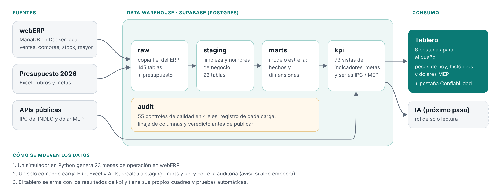
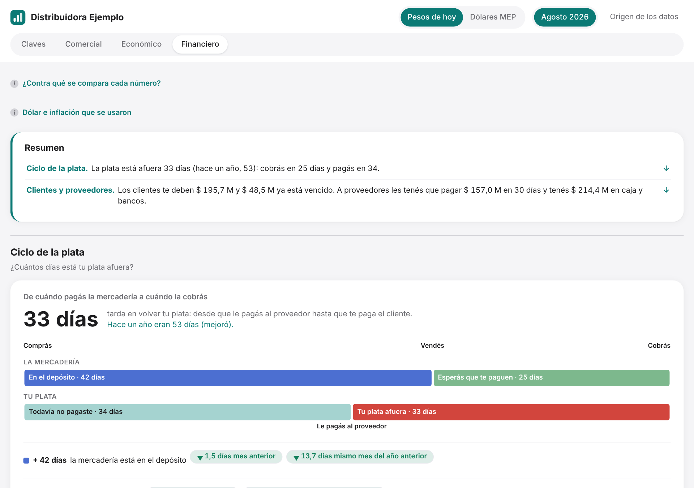
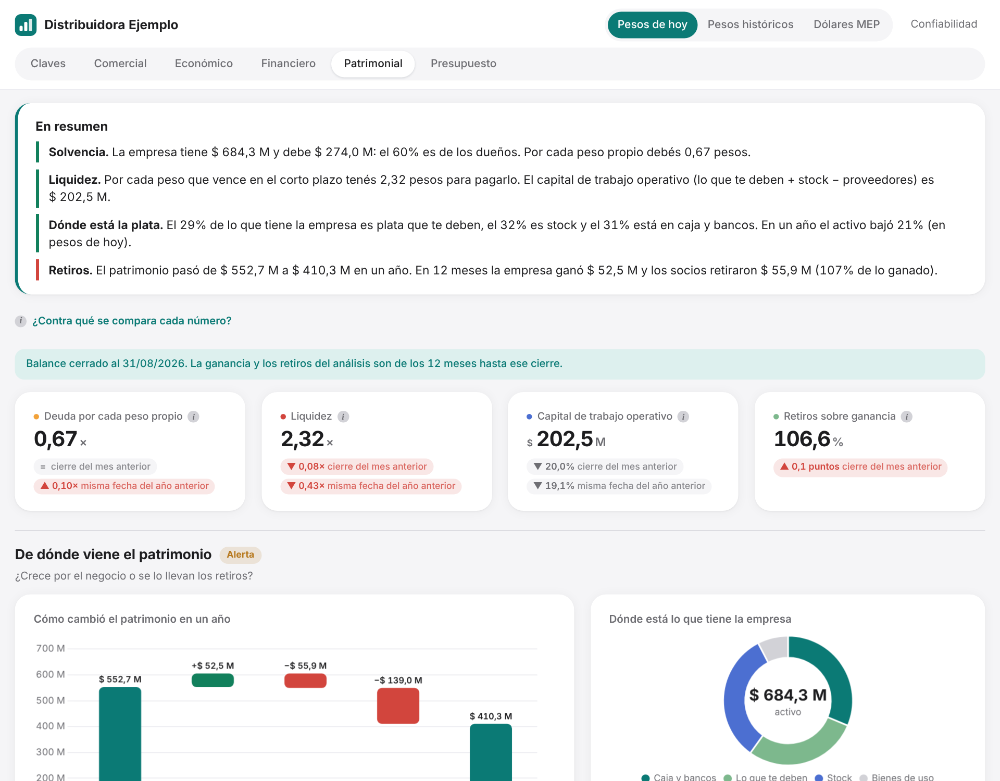
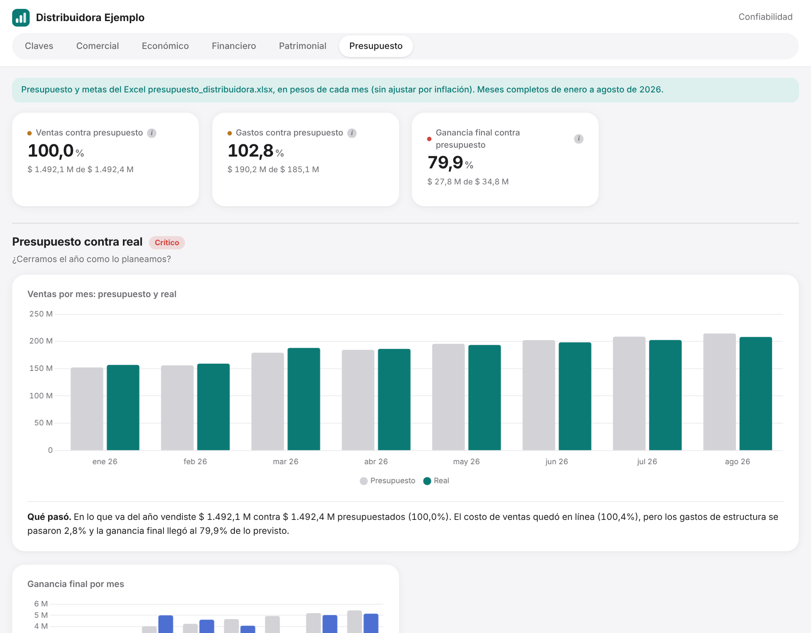

# BI para una distribuidora pyme: del ERP al tablero

Proyecto de Business Intelligence de punta a punta para el dueño de una distribuidora mayorista de consumo masivo. Va desde un ERP con 23 meses de operación hasta un tablero que responde las preguntas que el dueño se hace todos los meses, pasando por un data warehouse en capas, un modelo dimensional y una auditoría de calidad de datos.

**[Ver el tablero](https://claude.ai/artifact/UZ83beL8ZhC7Tk1EoA757A)** · **[Leer la documentación completa](https://claude.ai/code/artifact/686288c4-9ac2-47b0-87d4-9f3e2d46c97b)**

## El problema

El dueño de una pyme distribuidora tiene los datos en el ERP, pero no las respuestas: ¿vendo lo que esperaba?, ¿gano lo suficiente por cada venta?, ¿me alcanza la plata?, ¿quién me debe y desde cuándo? Es un negocio de margen bajo y mucho volumen, donde la plata queda atrapada en el stock y en las cuentas de los clientes. Por eso el tablero no mira solo la ganancia: también mira la caja, los plazos y la calidad de la cartera.

## Qué hice

| Etapa | Qué incluye | Herramientas |
| --- | --- | --- |
| ERP | webERP en Docker con 23 meses de operación simulada: 88.540 líneas de venta, 123 clientes, 1.460 productos y 15 proveedores, con contabilidad por partida doble | MariaDB, Docker, Python |
| Extracción y carga | Las 145 tablas del ERP, el presupuesto 2026 en Excel y la inflación (INDEC) y el dólar MEP desde APIs públicas | Python, pandas, SQLAlchemy |
| Data warehouse | Capas `raw` → `staging` → `marts` → `kpi`, con un modelo dimensional de 13 hechos y 8 dimensiones | PostgreSQL (Supabase) |
| Calidad de datos | 55 controles en cuatro ejes y un veredicto antes de usar los indicadores | SQL |
| Tablero | Seis pestañas pensadas para el dueño, en pesos de hoy, pesos históricos o dólares MEP | HTML, JavaScript, Chart.js |

## Documentación

- **[Modelo de datos](docs/modelo_datos.md):** el modelo estrella completo, con todas las tablas, columnas y relaciones, qué representa cada fila y las decisiones de modelado.
- **[Indicadores](docs/indicadores.md):** qué pregunta del dueño responde cada indicador, su fórmula, su meta y por qué importa en una distribuidora.
- **[Calidad de datos](docs/calidad_de_datos.md):** cómo se revisa cada carga antes de publicar, con ejemplos.

## Lo que distingue al proyecto

- **Indicadores con criterio de negocio.** Cada indicador responde una pregunta concreta y trae meta, estado, causa y una acción sugerida.
- **Los números cierran contra la contabilidad.** Cada cifra se calcula por al menos dos caminos (módulo comercial, ERP y libro mayor) y se comparan en cada carga.
- **Inflación tratada en serio.** Todo se puede ver en pesos de hoy (reexpresado con el IPC del INDEC), en pesos históricos o en dólares MEP.
- **Seguro por diseño.** La base no tiene acceso público y el tablero es una página estática sin credenciales.

## Las seis pestañas

| | |
| --- | --- |
| **Claves**: ¿qué pasó y qué miro primero?  | **Comercial**: ¿cuánto vendo y qué margen deja cada categoría?  |
| **Económico**: ¿cuánto gano y dónde se va la ganancia?  | **Financiero**: ¿me alcanza la plata? ¿a quién le cobro primero?  |
| **Patrimonial**: ¿qué tengo y qué debo?  | **Presupuesto**: ¿cumplo lo que planeé?  |

El tablero completo está en [tablero/index.html](tablero/index.html): se descarga y se abre con doble clic.

## Datos

Las ventas, costos y saldos de la distribuidora son **simulados**: el negocio, sus clientes y sus productos son ficticios. La inflación y el dólar MEP son datos reales. El escenario sirve para mostrar cómo funciona el modelo y el tablero, no para sacar conclusiones de un negocio real.

## Autor

Facundo Donari, contador público. Proyecto de portfolio para roles de Business Intelligence y análisis de datos.
