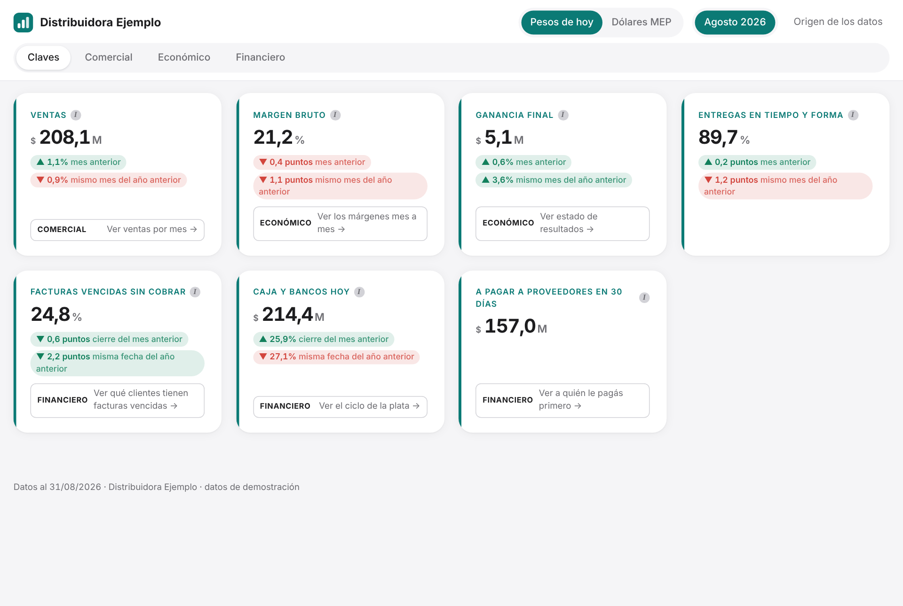
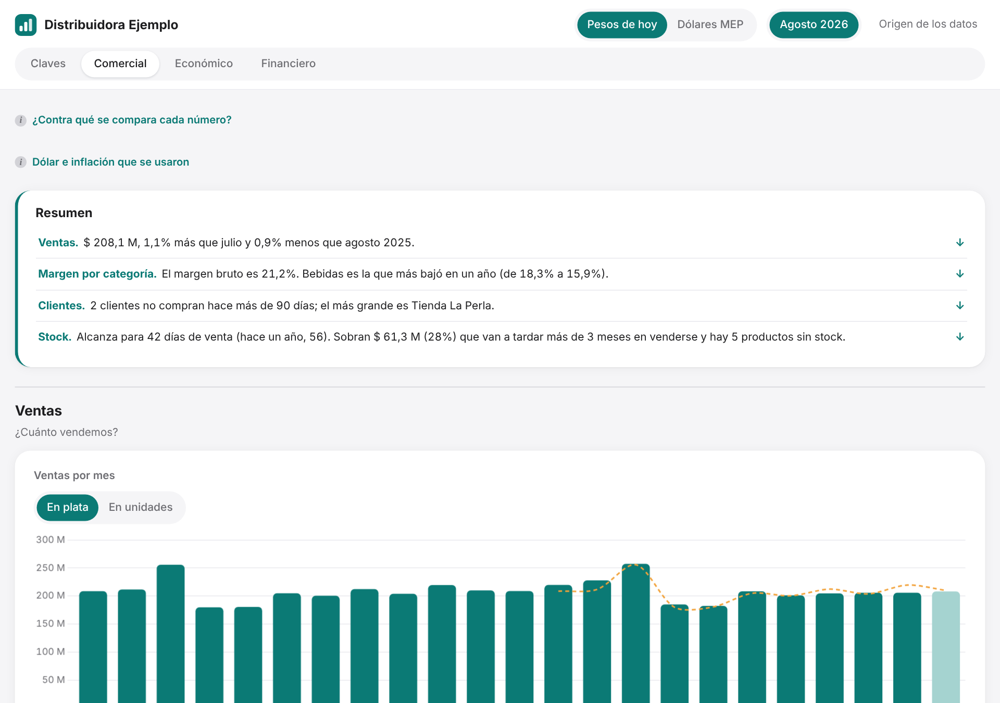
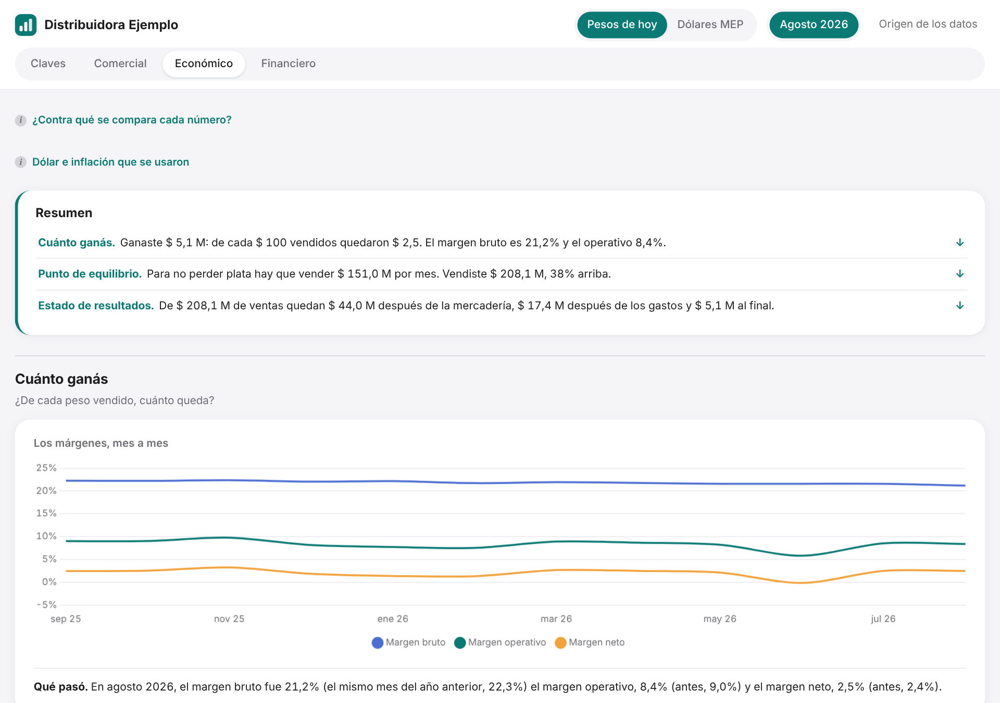

# BI para una distribuidora pyme: del ERP al tablero

Proyecto de Business Intelligence de punta a punta para el dueño de una distribuidora mayorista de consumo masivo. Arranca en un ERP con 23 meses de operación y termina en un tablero que responde las preguntas que el dueño se hace todos los meses. En el medio hay un data warehouse en capas, un modelo dimensional y una auditoría de calidad de datos.

**[Ver el tablero](https://claude.ai/artifact/UZ83beL8ZhC7Tk1EoA757A)**



## El problema

El dueño de una pyme distribuidora tiene los datos en el ERP, pero no las respuestas: ¿cuánto vendí?, ¿cuánto me queda de cada venta?, ¿me alcanza la plata?, ¿quién me debe y desde cuándo?, ¿qué mercadería me sobra y cuál me falta? Es un negocio de margen bajo y mucho volumen, donde la plata queda atrapada en el stock y en lo que deben los clientes. Por eso el tablero no mira solo la ganancia: también mira la caja, los plazos y el stock.

## Qué hice

| Etapa | Qué incluye | Herramientas |
| --- | --- | --- |
| ERP | webERP en Docker con 23 meses de operación simulada (octubre 2024 a agosto 2026): 88.540 líneas de venta, 123 clientes, 1.460 productos y 15 proveedores, con contabilidad por partida doble | MariaDB, Docker, Python |
| Extracción y carga | Las 145 tablas del ERP, el presupuesto 2026 en Excel y la inflación (INDEC) y el dólar MEP desde APIs públicas | Python, pandas, SQLAlchemy |
| Data warehouse | Capas `raw` → `staging` → `marts` → `kpi`, con un modelo dimensional de 13 hechos y 8 dimensiones | PostgreSQL (Supabase) |
| Calidad de datos | 63 controles en cuatro ejes (aprovechamiento, cobertura, frescura y veracidad) que avisan qué tan confiable es cada dato | SQL |
| Tablero | Cuatro pestañas para el dueño, con el mes de agosto 2026, en pesos de hoy o en dólares MEP | HTML, JavaScript, Chart.js |


## El tablero

Muestra **agosto de 2026** y lo compara con **julio de 2026** (el mes anterior) y con **agosto de 2025** (el mismo mes del año anterior). Los saldos son al 31/08/2026.

Se puede ver en dos monedas:

- **Pesos de hoy** (la vista por defecto): cada mes se lleva a pesos de agosto de 2026 con el IPC del INDEC, así las comparaciones muestran el crecimiento real.
- **Dólares MEP**: cada mes se divide por el dólar MEP del último día hábil de ese mes.

Arriba de cada pestaña hay un desplegable con la tabla de inflación y de dólar MEP usada mes por mes.

### Las cuatro pestañas

| Pestaña | Qué responde | Qué muestra |
| --- | --- | --- |
| **Claves** | ¿Cómo estoy este mes? | 7 tarjetas: ventas, margen bruto, ganancia final, entregas en tiempo y forma, facturas vencidas sin cobrar, caja y bancos hoy, y lo que hay que pagar a proveedores en 30 días. Cada una lleva a la pestaña donde está el detalle. |
| **Comercial** | ¿Cuánto vendo, qué deja cada categoría y cómo está el stock? | Ventas por mes (en plata o en unidades), ventas, unidades y margen por categoría, clientes que dejaron de comprar, y stock: días de stock mes a mes, mercadería que sobra (con un ejemplo de cómo se calcula) y productos que faltan o se están por terminar. |
| **Económico** | ¿Cuánto gano y dónde se va la ganancia? | Márgenes bruto, operativo y neto mes a mes, punto de equilibrio y estado de resultados mes a mes (3, 6, 9, 12 meses o todos), con el detalle de cada renglón. |
| **Financiero** | ¿Cuántos días está mi plata afuera? ¿A quién le cobro y a quién le pago primero? | Ciclo de la plata en una línea de tiempo (días de stock + días de cobro − días de pago), y el detalle de lo vencido de cada cliente y de lo que vence con cada proveedor. |

Comercial, Económico y Financiero empiezan con un **resumen**: una línea por cada gráfico de la pestaña. Al tocar una línea, la página baja a ese gráfico. Debajo de cada gráfico, un texto **"Qué pasó"** explica el resultado.

**Origen de los datos** (arriba a la derecha) explica cada indicador: su definición y las tablas del warehouse de las que sale.

| | |
| --- | --- |
| **Comercial**  | **Económico**  |
| **Financiero**  | |

El tablero completo es un solo archivo: [tablero/index.html](tablero/index.html). Se descarga y se abre con doble clic (necesita internet para cargar la librería de gráficos).

## Documentación

- **[Indicadores](docs/indicadores.md):** qué pregunta responde cada indicador del tablero, cómo se calcula y por qué importa en una distribuidora.
- **[Modelo de datos](docs/modelo_datos.md):** el modelo estrella completo, con todas las tablas, columnas y relaciones, qué representa cada fila y las decisiones de modelado.
- **[Calidad de datos](docs/calidad_de_datos.md):** cómo se revisa cada carga antes de usar los datos, con ejemplos.

## Lo que distingue al proyecto

- **Indicadores con criterio de negocio.** Cada indicador responde una pregunta concreta del dueño, se compara contra el mes anterior y contra el año anterior, y viene con una explicación en palabras simples.
- **Los números cierran contra la contabilidad.** Las ventas, el costo, los saldos y el stock se calculan por más de un camino (módulo comercial y libro mayor) y se comparan en cada carga.
- **Inflación tratada en serio.** Todo se ve en pesos de hoy, reexpresado con el IPC del INDEC, o en dólares MEP, y el tablero muestra los índices usados.
- **Seguro por diseño.** La base no tiene acceso público y el tablero es una página estática, sin credenciales ni conexión a la base.

## Estructura del repositorio

```
tablero/index.html     el tablero (un solo archivo, con los datos incluidos)
docs/indicadores.md    catálogo de indicadores
docs/modelo_datos.md   modelo dimensional del warehouse
docs/calidad_de_datos.md  auditoría de calidad de datos
docs/*.png, *.svg      arquitectura y diagramas del modelo
docs/capturas/         capturas del tablero
```

## Datos

Las ventas, costos y saldos de la distribuidora son **simulados**: el negocio, sus clientes y sus productos son ficticios. La inflación y el dólar MEP son datos reales. El escenario sirve para mostrar cómo funcionan el modelo y el tablero, no para sacar conclusiones de un negocio real.

## Autor

Facundo Donari, contador público. Proyecto de portfolio para roles de Business Intelligence y análisis de datos.
