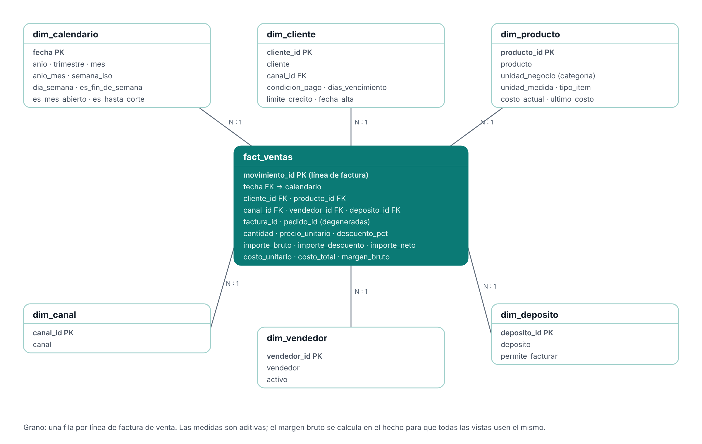
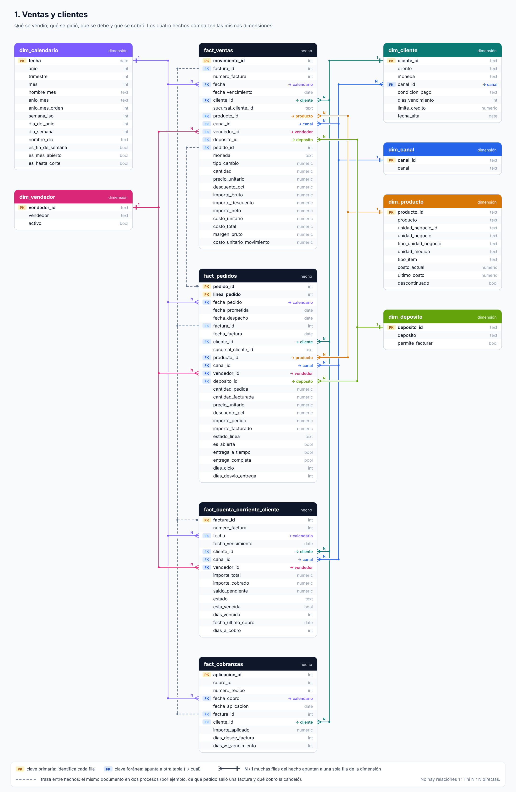
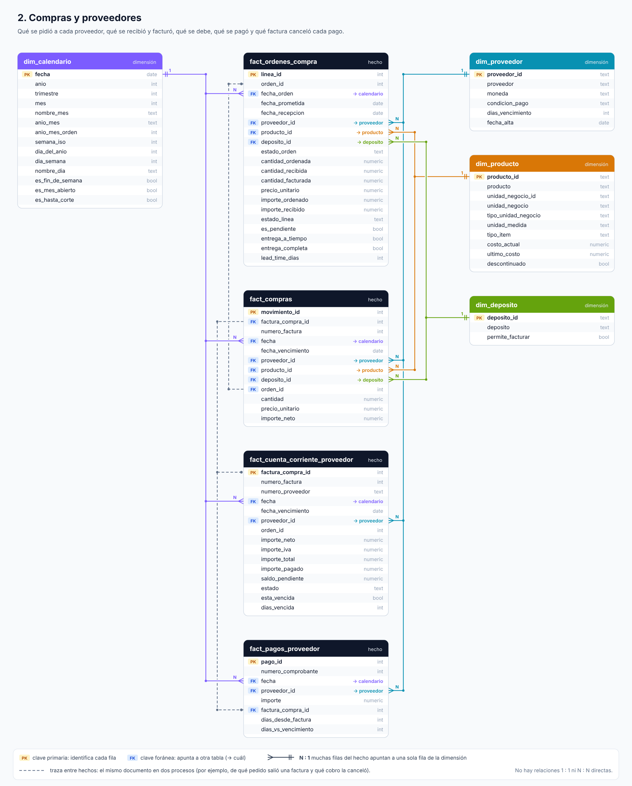
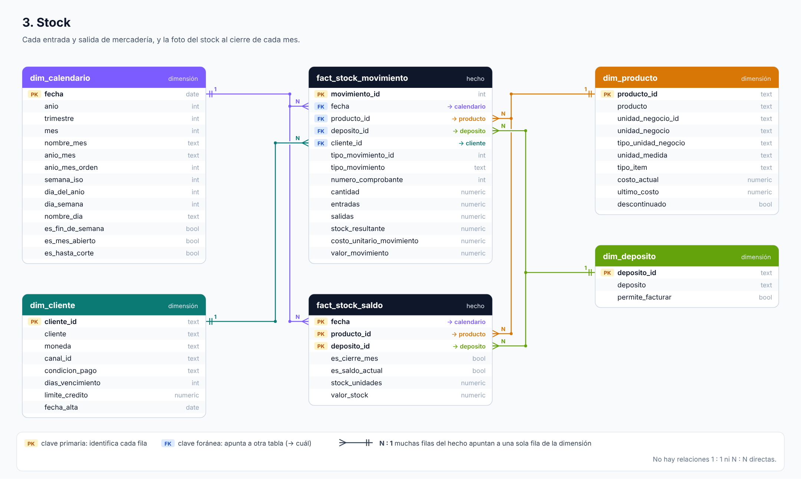
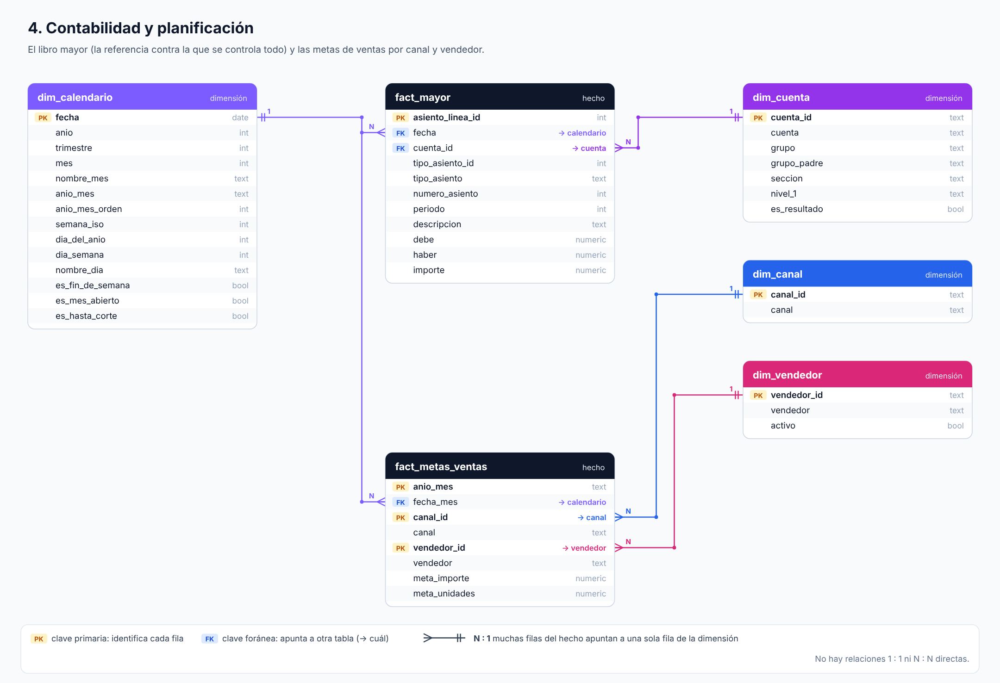

# Modelo de datos

**El modelado es la parte crucial del proyecto.** Es donde se mapean los procesos de la empresa (pedir, facturar, cobrar, comprar, pagar, mover stock, registrar en el mayor) y se decide qué representa cada fila. Si el modelo está bien hecho, no importa qué herramienta de BI se use encima (Power BI, Tableau o un agente conversacional conectado al warehouse): los números van a cerrar y las visualizaciones van a estar bien. Si está mal, ninguna herramienta lo arregla.

El warehouse está modelado en **estrella** (modelo dimensional de Kimball):

- **Hechos:** lo que pasa en el negocio y se puede medir. Una venta, un cobro, una compra, un movimiento de stock, un asiento contable. Hay 12.
- **Dimensiones:** desde dónde se mira lo que pasó. Cuándo (calendario), a quién (cliente), qué (producto), por dónde (canal), quién vendió (vendedor), desde dónde (depósito), a quién se compró (proveedor) y en qué cuenta contable. Hay 8.

Las 8 dimensiones son **compartidas**: el mismo cliente de una venta es el mismo cliente de un cobro. Por eso se puede cruzar "cuánto le vendí" con "cuánto me pagó" sin conciliar a mano.

## De un vistazo

`fact_ventas` es el centro del modelo: una fila por cada línea de factura, conectada a sus seis dimensiones. Los otros once hechos siguen la misma lógica.

## El modelo completo, por área

Cada diagrama muestra todas las tablas del área con todas sus columnas y tipos.

**Cómo leer los diagramas.** **PK** es la clave primaria (lo que identifica cada fila) y **FK** una clave foránea (la columna que apunta a otra tabla); al lado de cada FK dice a qué tabla apunta. Cada dimensión tiene una sola línea de su color que la une con todos los hechos que la usan. En las puntas se ve la cardinalidad: la pata de gallo (**N**) del lado del hecho y la doble raya (**1**) del lado de la dimensión. Todas las relaciones son de muchos a uno (**N:1**): muchas ventas son de un mismo cliente, pero cada venta tiene un solo cliente. No hay relaciones 1:1 ni de muchos a muchos directas: una relación de muchos a muchos, como la de clientes y productos, se resuelve a través de un hecho (`fact_ventas`). Las líneas grises punteadas siguen un mismo documento entre procesos, por ejemplo de qué pedido salió una factura y qué cobro la canceló.

### 1. Ventas y clientes

Qué se vendió, qué se pidió, qué se debe y qué se cobró.

**Por qué este modelo.** La venta pasa por cuatro momentos (pedido, factura, deuda y cobro). Cada uno ocurre en otro momento y se mide a otro nivel de detalle, así que cada uno es una tabla de hechos:

- **`fact_pedidos`, por línea de pedido:** compara lo que el cliente pidió con lo que se le entregó. Sin esta tabla no se puede medir "Entregas en tiempo y forma".
- **`fact_ventas`, por línea de factura:** ventas, unidades y margen por producto.
- **`fact_cuenta_corriente_cliente`, por factura:** la deuda nace y se cancela factura por factura. Cada una tiene su vencimiento (fecha más el plazo del cliente) y su saldo, y la fila se actualiza con cada cobro. Por cliente se perdería qué parte está vencida; por línea de producto, el saldo se duplicaría al sumar.
- **`fact_cobranzas`, por cobro aplicado a una factura:** un cobro puede cancelar varias facturas y una factura se puede cobrar en partes. Esta tabla resuelve ese muchos a muchos.

Juntar todo en una sola tabla duplicaría importes al sumar. Las cuatro se cruzan por las dimensiones que comparten (cliente, calendario, producto): primero se suma cada una por cliente y mes, y después se juntan. El número de documento permite seguir un pedido hasta su factura y su cobro.

### 2. Compras y proveedores

Qué se pidió a cada proveedor, qué se recibió y facturó, qué se debe, qué se pagó y qué factura canceló cada pago.

**Por qué este modelo.** Es el espejo de ventas y clientes, del otro lado del mostrador: orden de compra, factura del proveedor, deuda y pago. Cada momento es una tabla de hechos:

- **`fact_ordenes_compra`, por línea de orden de compra:** compara lo pedido al proveedor con lo recibido y la fecha prometida con la de llegada.
- **`fact_compras`, por línea de factura de compra:** cuánto se compró, a quién y a qué precio, por producto.
- **`fact_cuenta_corriente_proveedor`, por factura de compra:** la deuda nace y se cancela por factura. Cada una tiene su vencimiento y su saldo, y la fila se actualiza con cada pago.
- **`fact_pagos_proveedor`, por pago:** cada transferencia o cheque, con su fecha, su importe, la factura que canceló y cuántos días después de la factura y del vencimiento se pagó. En los datos cada pago cancela una sola factura (algunas facturas se pagan en partes), así que alcanza con guardar la factura en la misma fila.

Las tablas se cruzan por las dimensiones que comparten (proveedor, calendario, producto). El producto es el mismo que en ventas, así que se puede comparar el costo de compra con el precio de venta. El número de documento permite seguir una compra desde la orden hasta el pago.

### 3. Stock

Cada entrada y salida de mercadería, y la foto del stock al cierre de cada mes.

### 4. Contabilidad y planificación

El libro mayor, que es la referencia contra la que se controla todo, y las metas de ventas.

## Qué representa cada fila

La decisión más importante de un hecho es su **grano**: qué es exactamente una fila. Define qué se puede sumar sin contar dos veces lo mismo.

| Hecho | Una fila es… | Tipo | Uso en el tablero |
| --- | --- | --- | --- |
| `fact_ventas` | Una línea de factura de venta | Transaccional | Ventas, unidades, margen, categorías, clientes que dejaron de comprar |
| `fact_pedidos` | Una línea de pedido | Acumulativo: se completa al despachar y al facturar | Entregas en tiempo y forma |
| `fact_cuenta_corriente_cliente` | Una factura, con lo cobrado y lo que falta | Acumulativo | Facturas vencidas sin cobrar, días de cobro, detalle de clientes |
| `fact_cobranzas` | La aplicación de un cobro a una factura | Transaccional | Días de cobro |
| `fact_ordenes_compra` | Una línea de orden de compra | Acumulativo | No se usa |
| `fact_compras` | Una línea de factura de compra | Transaccional | No se usa |
| `fact_cuenta_corriente_proveedor` | Una factura de compra, con lo pagado y lo que falta | Acumulativo | Días de pago, a pagar en 30 días, detalle de proveedores |
| `fact_pagos_proveedor` | Un pago a un proveedor, con la factura que canceló | Transaccional | Días de pago |
| `fact_stock_movimiento` | Una entrada o salida de stock | Transaccional | No se usa (el stock sale de la foto de cierre) |
| `fact_stock_saldo` | Producto × depósito × fecha de cierre | Foto periódica | Días de stock, mercadería que sobra y que falta |
| `fact_mayor` | Una línea de asiento contable | Transaccional | Estado de resultados, márgenes, punto de equilibrio, caja y bancos |
| `fact_metas_ventas` | Mes × canal × vendedor | Plan | No se usa |

El modelo se armó para un proyecto más amplio y después el tablero se simplificó: los hechos que dicen "No se usa" quedan en el warehouse, listos para crecer (por ejemplo, comparar contra las metas o analizar compras), pero el tablero de hoy no los muestra.

**Transaccional:** cada fila es un evento que no cambia. **Acumulativo:** cada fila es un documento que se va completando a medida que avanza (un pedido se despacha, se factura y se cobra). **Foto periódica:** cada fila es el estado de algo a una fecha.

## Matriz de procesos y dimensiones

Qué dimensiones usa cada hecho. Es la forma rápida de ver qué preguntas se pueden responder cruzando procesos.

| Hecho | Calendario | Cliente | Producto | Canal | Vendedor | Depósito | Proveedor | Cuenta |
| --- | :-: | :-: | :-: | :-: | :-: | :-: | :-: | :-: |
| `fact_ventas` | ● | ● | ● | ● | ● | ● | | |
| `fact_pedidos` | ● | ● | ● | ● | ● | ● | | |
| `fact_cuenta_corriente_cliente` | ● | ● | | ● | ● | | | |
| `fact_cobranzas` | ● | ● | | | | | | |
| `fact_ordenes_compra` | ● | | ● | | | ● | ● | |
| `fact_compras` | ● | | ● | | | ● | ● | |
| `fact_cuenta_corriente_proveedor` | ● | | | | | | ● | |
| `fact_pagos_proveedor` | ● | | | | | | ● | |
| `fact_stock_movimiento` | ● | ● | ● | | | ● | | |
| `fact_stock_saldo` | ● | | ● | | | ● | | |
| `fact_mayor` | ● | | | | | | | ● |
| `fact_metas_ventas` | mes | | | ● | ● | | | |

## Decisiones de modelado

- **Un calendario propio.** Una fila por día, con año, trimestre, mes, semana y dos marcas: si el mes ya cerró y si la fecha está dentro del período analizado. Así, comparar contra el mismo mes del año anterior o dejar afuera el mes en curso es un filtro y no una fórmula.
- **Números de documento dentro del hecho.** El número de factura y el de pedido quedan en la fila (dimensiones degeneradas): no necesitan tabla propia y permiten seguir cada línea hasta su comprobante.
- **El margen se calcula una sola vez.** Vive en `fact_ventas`, y todas las vistas usan ese mismo número.
- **Saldos calculados desde los movimientos.** El stock y lo que debe cada cliente se calculan sumando movimientos, no copiando el saldo que guarda el ERP. Después se controla que los dos coincidan.
- **El libro mayor como referencia.** Cada cifra comercial se puede comparar contra su cuenta contable: ventas contra Ventas, lo que te deben contra Deudores por ventas, el stock contra Mercaderías.
- **La lógica de negocio en una sola capa.** Encima del modelo, la capa `kpi` tiene una vista por indicador, con su comparación contra el mes anterior y el año anterior. El tablero toma sus números de esas vistas: si cambia una definición, se cambia en un solo lugar. Algunos cortes puntuales del tablero (unidades y margen por categoría del mes anterior, productos que faltan y el ejemplo de stock) se consultaron directo sobre `marts` con los mismos criterios.

## Las capas del warehouse

| Capa | Qué tiene |
| --- | --- |
| `raw` | Copia exacta de las 145 tablas del ERP, sin tocar |
| `staging` | Los mismos datos, limpios y con nombres de negocio |
| `marts` | El modelo de esta página: hechos y dimensiones |
| `kpi` | Una vista por indicador (el tablero de hoy usa una parte) |
| `audit` | Los controles de [calidad de datos](calidad_de_datos.md) |
